# Current system architecture

## Implemented runtime

The repository contains two npm workspaces. The NestJS API composes validated global configuration, an application-scoped Neo4j driver/schema provider, and `HealthModule`. `/health` is static process liveness; `/ready` checks the configured Neo4j database and foundation schema. The React app owns one `BrowserRouter`, a home route, not-found route, shared JSON HTTP transport and page-scoped health state. The UI's existing health contract remains unchanged.

```mermaid
flowchart LR
  Browser[Browser: React 19] --> Router[App / BrowserRouter]
  Router --> Home[Home page]
  Home --> Health[Home health API + state hook]
  Health --> Client[Shared JSON HTTP client]
  Client -->|GET /api/health| Vite[Vite dev server / proxy]
  Vite -->|strip /api| Nest[NestJS API]
  Nest --> Root[AppModule]
  Root --> Config[ConfigModule + environment validation]
  Root --> HealthModule[HealthModule]
  HealthModule --> Neo4jModule[Neo4jModule: driver + explicit DB sessions]
  Neo4jModule --> Neo4j[(Configured Neo4j database)]
  HealthModule --> Controller[HealthController: GET /health]
  HealthModule --> Ready[ReadinessController: GET /ready]
  Ready --> Schema[Schema version/readiness service]
  Schema --> Neo4jModule
```

This is not a future-state data architecture. The Neo4j foundation has no login, user domain, event log, ETL, model, or production proxy. Database runtime/privilege verification must be recorded separately from source implementation and builds.

## Dependency direction

API bootstrap starts `AppModule`; the root module composes feature/configuration modules. The health controller has no service/repository because its response has no business or persistence behavior. On the web, `app/` composes routes, routes load pages, and home code uses `shared/` transport/config. The web workspace does not import API source.

The application foundation architecture review reported PASS. Details/evidence live in `task/setup-application-foundation/todo.md`; that handoff is historical evidence, not an ongoing implementation specification.
