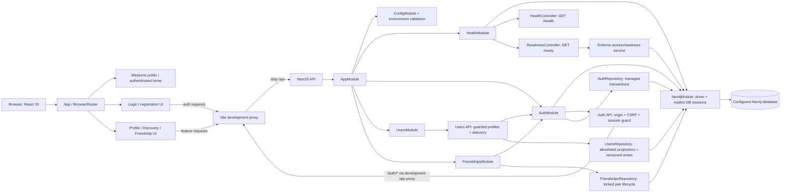

# Current system architecture

## Implemented runtime

The repository contains two npm workspaces. The NestJS API composes validated configuration, an application-scoped Neo4j driver/migration provider, `HealthModule`, `AuthModule`, `UsersModule`, and `FriendshipsModule`. `/health` is process liveness; `/ready` checks configured database identity and V4 migration/catalog readiness. The React app owns one `BrowserRouter`, Weylume public/authenticated home states, authentication routes, protected profile/discovery/friendship routes, shared API/config boundaries, and not-found handling. The public homepage does not make a health request. Browser authentication uses an HttpOnly session cookie, CSRF/origin defense, and Neo4j-backed session restoration.

This diagram includes the Friendship implementation. Build records report V4 applied to both approved databases; resumed Step 6 gates verified current restricted `isn-test` V4 state, and corrected real graph concurrency plus interactive UI acceptance passed with the original test-data baseline restored. Posts/interactions, recommendations, ETL, ML, production routing and account recovery remain unimplemented. Event retention policy is unresolved and there is no pruning job. Database identity/privilege checks are recorded separately from source implementation and builds.

## Dependency direction

API bootstrap starts `AppModule`; the root module composes feature/configuration modules. Health stays independent of the database; auth and users providers use the app-scoped Neo4j driver through their repositories. On the web, `app/` composes routes, auth owns session state, profile/discovery own their API and screens, and shared code owns base URL/config and presentation primitives. Health/readiness remain operational API contracts, not public homepage content. The web workspace does not import API source.

The application foundation architecture review reported PASS. Details/evidence live in `task/setup-application-foundation/todo.md`; that handoff is historical evidence, not an ongoing implementation specification.
