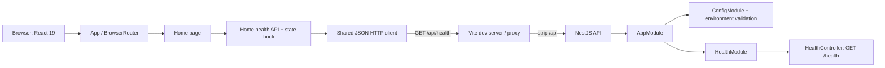

# Current system architecture

## Implemented runtime

The repository contains two npm workspaces and no persistence or external data services. The NestJS API composes validated global configuration and a single `HealthModule`. Its controller returns a static liveness response. The React app owns one `BrowserRouter`, a home route, not-found route, shared JSON HTTP transport and page-scoped health state. The health contract is validated at runtime before the UI reports success.

This is not a future-state data architecture. There is no login, user domain, Neo4j, event log, ETL, model, or production proxy in the current runtime.

## Dependency direction

API bootstrap starts `AppModule`; the root module composes feature/configuration modules. The health controller has no service/repository because its response has no business or persistence behavior. On the web, `app/` composes routes, routes load pages, and home code uses `shared/` transport/config. The web workspace does not import API source.

The application foundation architecture review reported PASS. Details/evidence live in `task/setup-application-foundation/todo.md`; that handoff is historical evidence, not an ongoing implementation specification.
