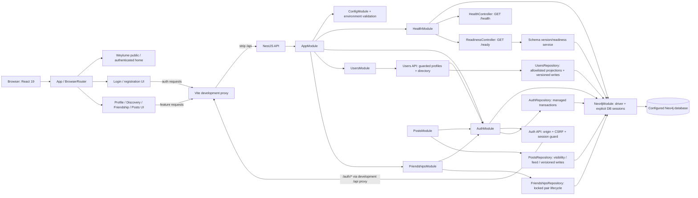

# Current system architecture

## Implemented runtime

The repository contains two npm workspaces. The NestJS API composes validated configuration, an application-scoped Neo4j driver/migration provider, `HealthModule`, `AuthModule`, `UsersModule`, `FriendshipsModule`, and `PostsModule`. `/health` is process liveness; source `/ready` expects V5 migration/catalog readiness. V5 readiness and focused Posts behavior were verified on restricted `isn-test` in a separately Owner-authorized continuation; this does not establish `isn-dev` or production readiness. The React app owns one `BrowserRouter`, Weylume public/authenticated home states, authentication routes, protected profile/discovery/friendship/Posts routes, shared API/config boundaries, and not-found handling. The public homepage does not make a health request. Browser authentication uses an HttpOnly session cookie, CSRF/origin defense, and Neo4j-backed session restoration.

This diagram includes the Posts & Feed source module and UI. Historical V1–V4 database and Friendship acceptance evidence remains unchanged. In the Owner-authorized ISN-C continuation, V5 and the reviewed Post grant delta were applied only on `isn-test`; the real Posts fixture/query suite passed and restored its baseline. Step 5 had not yet been performed at that point in the history; it was subsequently accepted by the Owner, and Step 6 is complete (see the [Posts acceptance report](../../tests/e2e/posts-feed-acceptance.md)). Interactions, recommendations, ETL, ML, production routing and account recovery remain unimplemented. Event retention policy is unresolved and there is no pruning job. Database identity/privilege checks are recorded separately from source implementation and builds.

## Dependency direction

API bootstrap starts `AppModule`; the root module composes feature/configuration modules. Health stays independent of the database; auth and users providers use the app-scoped Neo4j driver through their repositories. On the web, `app/` composes routes, auth owns session state, profile/discovery own their API and screens, and shared code owns base URL/config and presentation primitives. Health/readiness remain operational API contracts, not public homepage content. The web workspace does not import API source.

The application foundation architecture review reported PASS. Details/evidence live in `task/setup-application-foundation/todo.md`; that handoff is historical evidence, not an ongoing implementation specification.
