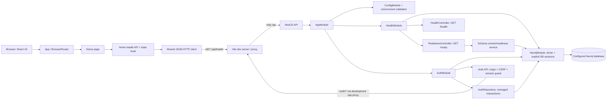

# Current system architecture

## Implemented runtime

The repository contains two npm workspaces. The NestJS API composes validated configuration, an application-scoped Neo4j driver/migration provider, `HealthModule`, and `AuthModule`. `/health` is process liveness; `/ready` checks configured database identity and migration schema. The React app owns one `BrowserRouter`, health/authenticated home states, registration/login routes, shared HTTP/config boundaries, and not-found handling. Browser authentication uses a HttpOnly session cookie, CSRF/origin defense, and Neo4j-backed session restoration.

This diagram covers the implemented authentication foundation only; it is not a future-state social/data architecture. Profiles, social graph features, ETL, ML, production routing and account recovery remain unimplemented. Event retention policy is unresolved and there is no pruning job. Database identity/privilege checks are recorded separately from source implementation and builds.

## Dependency direction

API bootstrap starts `AppModule`; the root module composes feature/configuration modules. Health stays independent of the database; auth providers use the app-scoped Neo4j driver through the auth repository. On the web, `app/` composes routes, the auth feature owns account API/state/UI, pages compose the home/status view, and shared code owns base URL/config. The web workspace does not import API source.

The application foundation architecture review reported PASS. Details/evidence live in `task/setup-application-foundation/todo.md`; that handoff is historical evidence, not an ongoing implementation specification.
