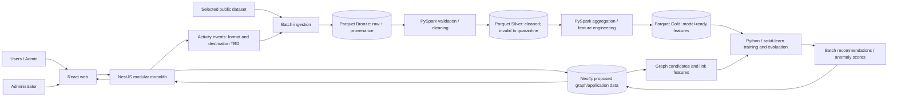

# Proposed Big Data architecture

## Target responsibilities

The project proposal separates interactive application transactions from batch data engineering and model work. This is conceptual only; no associated code, Neo4j instance, data store or integration exists today.

## Data and graph intent

The proposal suggests Neo4j nodes for `User`, `Post`, `Comment`, `AnomalyAlert`; relationships for `FRIENDS_WITH`, directed `SENT_REQUEST`, content authorship/likes/comments, `RECOMMENDED` and `HAS_ALERT`. Recommendation outputs may carry score, model version and computation time. A logical friendship should be represented once per pair. Detailed activity events may remain in Parquet rather than one graph node per event. This graph is not an approved production schema: constraints, uniqueness, request history, temporal semantics, deletion, privacy and Neo4j/GDS versions require design before implementation.

## Proposed responsibilities

- **NestJS:** interactive REST behavior and friendship transactions; proposal says accepted friendships are written to Neo4j in the business flow.
- **Activity collection:** structured event records; JSON Lines/Parquet ingestion is a possible first step.
- **PySpark:** schema checks, normalization, deduplication, missing-value handling, aggregation and features.
- **Parquet layers:** Bronze keeps original inputs and provenance; Silver holds cleaned data with invalid rows quarantined; Gold contains features for model work.
- **Python/scikit-learn:** batch training/scoring, evaluation, and publishing versioned recommendation/alert outputs.
- **Optional Kafka:** a possible later near-real-time path; not required for the initial batch proposal.

Consistency between API writes, graph persistence and event delivery, failure recovery, storage paths, scheduling, model serving, and refresh cadence are open decisions. Recommendations/alerts are outputs for review, not ground truth or automated account sanctions.
